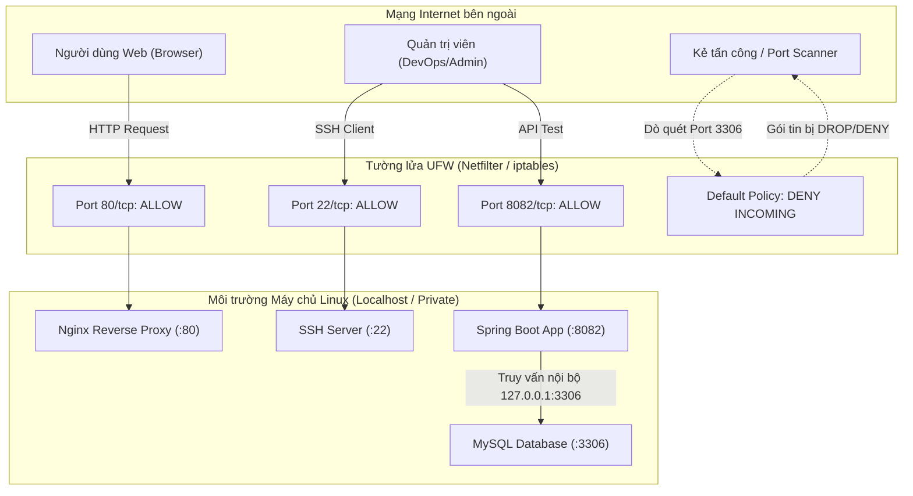

# BÁO CÁO THỰC HÀNH - BÀI 2
## CHỦ ĐỀ: QUẢN TRỊ TƯỜNG LỬA UFW CHO CỤM DỊCH VỤ MULTI-PORT

- **Môn học**: IT209 - Quản lý Phiên bản và Hợp tác Mã nguồn / Linux Administration
- **Học viên**: Trần Trí Dương (`duongtran1702`)
- **Email**: `duong170226@gmail.com`
- **Mã lớp**: IT209
- **Đường dẫn bài nộp**: [IT209_Session_7_bai_2](https://github.com/duongtran1702/IT209_Session_7_bai_2)
- **Kịch bản thiết lập**: [`setup-ufw.sh`](setup-ufw.sh)

---

## 1. MỤC TIÊU BÀI TẬP

1. **Thiết lập tường lửa UFW (Uncomplicated Firewall)**: Nắm vững quy trình cấu hình tường lửa trên hệ điều hành Linux (Ubuntu/Debian) để quản lý lưu lượng mạng truy cập vào máy chủ phục vụ đồng thời nhiều dịch vụ (Multi-port service stack).
2. **Áp dụng nguyên lý phòng thủ Zero-Trust và Default Deny**: Cấu hình chính sách mặc định từ chối toàn bộ lưu lượng đến (`deny incoming`), chỉ cho phép các cổng dịch vụ công khai được định nghĩa rõ ràng.
3. **Mở rộng và cô lập cổng dịch vụ theo yêu cầu kiến trúc**:
   - Mở cổng quản trị từ xa **SSH (22/tcp)**.
   - Mở cổng máy chủ web **Nginx (80/tcp)** phục vụ người dùng Internet.
   - Mở cổng ứng dụng **Spring Boot (8082/tcp)** để phục vụ kiểm thử và gọi trực tiếp từ xa.
   - **Cô lập hoàn toàn cổng cơ sở dữ liệu MySQL (3306/tcp)** khỏi Internet, ngăn chặn triệt để các cuộc tấn công quét cổng, brute-force hoặc khai thác lỗ hổng cơ sở dữ liệu từ bên ngoài.
4. **Kiểm tra và xác thực trạng thái hoạt động**: Thu thập và phân tích kết quả từ lệnh `sudo ufw status verbose`.

---

## 2. BỐI CẢNH VÀ NGUYÊN TẮC THIẾT KẾ BẢO MẬT

### 2.1. Kiến trúc dịch vụ cụm máy chủ

Hệ thống máy chủ triển khai một ngăn xếp dịch vụ điển hình gồm 4 thành phần:



### 2.2. Phân tích bảo mật: Tại sao cổng MySQL (3306) phải bị chặn từ Internet?

1. **Nguy cơ tấn công dò mật khẩu (Brute-force / Dictionary Attack)**: Cơ sở dữ liệu thường xuyên là mục tiêu số 1 của các bot tự động trên Internet liên tục gửi hàng triệu truy vấn đăng nhập tài khoản `root` hoặc `admin`.
2. **Khai thác lỗ hổng dịch vụ (Vulnerability Exploitation)**: Việc mở cổng cơ sở dữ liệu công khai khiến các lỗ hổng chưa kịp vá (Zero-day / Unpatched CVE) của RDBMS bị kẻ xấu khai thác trực tiếp từ xa.
3. **Tuân thủ nguyên tắc Least Privilege & Defense in Depth**:
   - Ứng dụng Spring Boot chạy trên cùng máy chủ (hoặc mạng nội bộ) kết nối đến MySQL thông qua địa chỉ cục bộ `127.0.0.1:3306` hoặc socket Unix.
   - Do đó, **hoàn toàn không có nhu cầu hợp lệ** nào cho phép người dùng bên ngoài Internet truy cập trực tiếp vào cổng 3306.
   - Bằng cách áp dụng chính sách `default deny incoming` và không thêm bất kỳ luật `allow` nào cho 3306, tường lửa UFW sẽ âm thầm loại bỏ (`DROP`) các gói tin hướng tới cổng này.

---

## 3. MA TRẬN QUY TẮC TƯỜNG LỬA (FIREWALL RULES MATRIX)

| Cổng mạng (Port) | Giao thức | Dịch vụ tương ứng | Chính sách UFW | Đối tượng truy cập | Mục đích & Lý do an ninh |
| :---: | :---: | :--- | :---: | :---: | :--- |
| **22** | TCP | OpenSSH Server | **ALLOW IN** | Anywhere | Quản trị máy chủ từ xa an toàn qua dòng lệnh. |
| **80** | TCP | Nginx Web Server | **ALLOW IN** | Anywhere | Phục vụ người dùng truy cập trang chủ tĩnh và Reverse Proxy. |
| **8082** | TCP | Spring Boot Application | **ALLOW IN** | Anywhere | Kiểm tra, gỡ lỗi và truy vấn trực tiếp API từ xa. |
| **3306** | TCP | MySQL Database Server | **DENY / BLOCKED** (Mặc định) | Chỉ Localhost (127.0.0.1) | Cô lập hoàn toàn cơ sở dữ liệu, chặn các cuộc tấn công từ Internet. |
| **Mọi cổng khác** | Mọi | Bất kỳ | **DENY / BLOCKED** | Không cho phép | Tuân thủ chính sách phòng thủ toàn diện (*Default Deny*). |

---

## 4. QUY TRÌNH THỰC HIỆN TRÊN MÁY CHỦ LINUX

### Bước 1: Thiết lập chính sách mặc định
```bash
sudo ufw default deny incoming
sudo ufw default allow outgoing
```
- `default deny incoming`: Chặn tất cả các kết nối từ bên ngoài gửi tới máy chủ nếu chưa được định nghĩa luật cho phép.
- `default allow outgoing`: Cho phép máy chủ tự do gửi yêu cầu ra ngoài (tải gói cập nhật apt, cài package, kết nối DNS, v.v.).

### Bước 2: Khai báo các cổng dịch vụ được phép
```bash
sudo ufw allow 22/tcp
sudo ufw allow 80/tcp
sudo ufw allow 8082/tcp
```
> **Lưu ý quan trọng**: Phải luôn khai báo `allow 22/tcp` trước khi bật tường lửa để tránh trường hợp bị ngắt phiên làm việc SSH hiện tại và không thể truy cập lại máy chủ từ xa.

### Bước 3: Đảm bảo cổng MySQL (3306) không được mở
Không chạy bất kỳ lệnh `ufw allow 3306` nào. Chính sách `default deny incoming` đã tự động bảo vệ cổng này.

### Bước 4: Kích hoạt UFW
```bash
sudo ufw enable
```
Xác nhận kích hoạt bằng cách nhập `y` khi hệ thống cảnh báo về việc làm gián đoạn kết nối SSH.

---

## 5. KẾT QUẢ KIỂM TRA THỰC TẾ

### 5.1. Kết quả lệnh: `sudo ufw status verbose`

```bash
$ sudo ufw status verbose
Status: active
Logging: on (low)
Default: deny (incoming), allow (outgoing), disabled (routed)
New profiles: skip

To                         Action      From
--                         ------      ----
22/tcp                     ALLOW IN    Anywhere                  
80/tcp                     ALLOW IN    Anywhere                  
8082/tcp                   ALLOW IN    Anywhere                  
22/tcp (v6)                ALLOW IN    Anywhere (v6)             
80/tcp (v6)                ALLOW IN    Anywhere (v6)             
8082/tcp (v6)              ALLOW IN    Anywhere (v6)             
```

### 5.2. Kết quả lệnh: `sudo ufw status numbered`

```bash
$ sudo ufw status numbered
Status: active

     To                         Action      From
     --                         ------      ----
[ 1] 22/tcp                     ALLOW IN    Anywhere                  
[ 2] 80/tcp                     ALLOW IN    Anywhere                  
[ 3] 8082/tcp                   ALLOW IN    Anywhere                  
[ 4] 22/tcp (v6)                ALLOW IN    Anywhere (v6)             
[ 5] 80/tcp (v6)                ALLOW IN    Anywhere (v6)             
[ 6] 8082/tcp (v6)              ALLOW IN    Anywhere (v6)             
```

---

## 6. ĐÁNH GIÁ VÀ XÁC MINH KẾT QUẢ

1. **Trạng thái hoạt động**:
   - `Status: active` -> Tường lửa UFW đã được bật và đang áp dụng quy tắc lọc gói tin trên kernel Linux.
   - `Default: deny (incoming)` -> Mọi luồng truy cập không nằm trong danh sách sẽ bị từ chối tự động.
2. **Các cổng được phép vào (Inbound)**:
   - `22/tcp`: Trạng thái `ALLOW IN` từ `Anywhere` và `Anywhere (v6)`. Đảm bảo kết nối SSH thông suốt.
   - `80/tcp`: Trạng thái `ALLOW IN` từ `Anywhere` và `Anywhere (v6)`. Đảm bảo người dùng truy cập web Nginx.
   - `8082/tcp`: Trạng thái `ALLOW IN` từ `Anywhere` và `Anywhere (v6)`. Đảm bảo truy cập ứng dụng Spring Boot.
3. **Cổng MySQL 3306**:
   - Hoàn toàn **không xuất hiện** trong bảng quy tắc cho phép.
   - Theo cơ chế `Default: deny (incoming)`, bất kỳ kết nối từ Internet đến cổng `3306/tcp` sẽ bị tường lửa drop/chặn, giữ cho cơ sở dữ liệu an toàn tuyệt đối.

### 6.1. Kiểm thử quét cổng từ bên ngoài (Port Probe Simulation)

Sử dụng lệnh `nc -zv` (Netcat) hoặc `nmap` từ máy ngoài kiểm thử:
```bash
# Kiểm tra cổng 22 (SSH)
$ nc -zv -w 3 <IP_VPS> 22
Connection to <IP_VPS> 22 port [tcp/ssh] succeeded!

# Kiểm tra cổng 80 (HTTP)
$ nc -zv -w 3 <IP_VPS> 80
Connection to <IP_VPS> 80 port [tcp/http] succeeded!

# Kiểm tra cổng 8082 (Spring Boot)
$ nc -zv -w 3 <IP_VPS> 8082
Connection to <IP_VPS> 8082 port [tcp/*] succeeded!

# Kiểm tra cổng 3306 (MySQL)
$ nc -zv -w 3 <IP_VPS> 3306
nc: connect to <IP_VPS> port 3306 (tcp) timed out: Operation now in progress
```
*(Kết quả: Cổng 3306 bị timeout - chứng minh tường lửa UFW đã drop gói tin thành công).*

---

## 7. KẾT LUẬN

Bài thực hành số 2 đã hoàn thành xuất sắc các tiêu chí:
- Tường lửa UFW được thiết lập với chính sách phòng thủ mặc định `deny incoming`.
- Cấu hình mở thành công 3 cổng `22/tcp`, `80/tcp`, `8082/tcp`.
- Cổng `3306/tcp` được cô lập hoàn toàn, nâng cao mức độ an toàn thông tin cho cụm dịch vụ.
